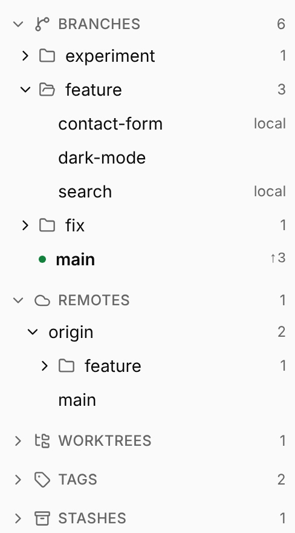
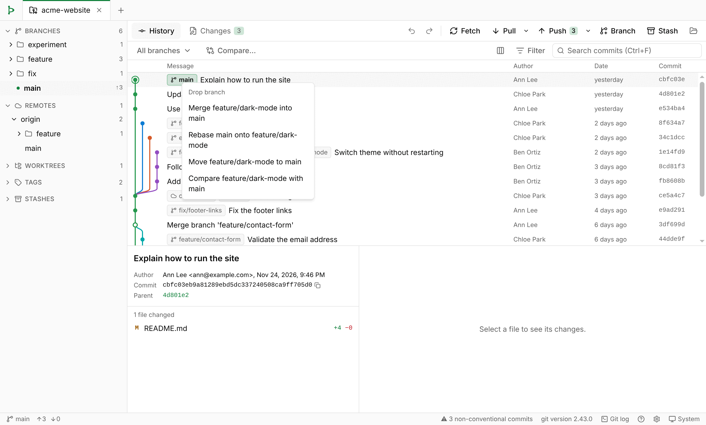
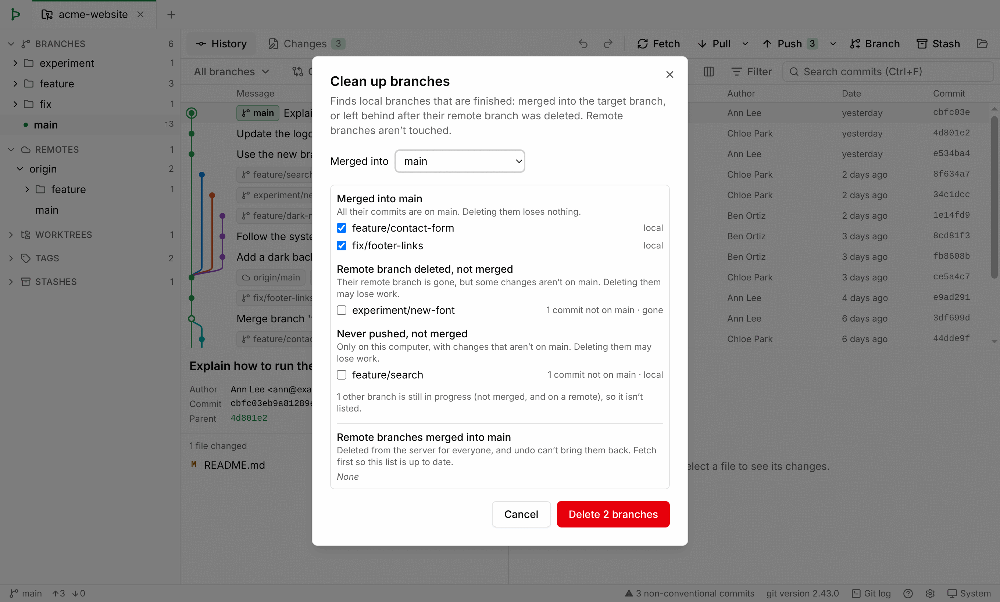

# Branches and remotes

A **branch** is a line of work. You usually keep `main` working and do each change on its own branch, then merge it back. A **remote** (usually called `origin`) is a copy of the repository on a server such as GitHub, which you **fetch** from, **pull** from and **push** to.

## Creating and switching branches

- **Create**: **Branch** in the toolbar, or right-click a commit and choose **Create branch here…**. Leave **Switch to the new branch** ticked to start working on it.
- **Switch**: **double-click** the branch in the sidebar, or right-click it and choose **Check out**. Trellis shows "Switching to…" while it works.
- **Remote branches** (under **Remotes** in the sidebar, like `origin/feature`): double-click one to get a local `feature` branch that tracks it, created if needed.
- Double-clicking a commit in the history also checks out its branch. A commit with no branch asks first, because you'd be on no branch ("detached HEAD").

Right-click a branch for everything else: rename, delete, merge, rebase, push, compare, and more.

### Branch folders

Branches named with slashes are grouped into folders, like files: `feature/login` and `feature/search` appear inside a **feature** folder, and `team/ann/fix` inside **team › ann**. Click a folder to open or close it; the number shows how many branches are inside. The folder holding the branch you're on starts open. Remote branches are grouped the same way under their remote.

Branches in folders work exactly like the others: double-click, right-click and drag them as usual.

### What the markers mean

The sidebar shows how each branch relates to its remote:

| Marker           | Meaning                                                                   |
| ---------------- | ------------------------------------------------------------------------- |
| `↑3`             | 3 commits you haven't pushed yet.                                         |
| `↓2`             | 2 commits on the remote you haven't pulled yet.                           |
| **local**        | Never pushed: it only exists on this computer.                            |
| **gone**         | Its remote branch was deleted, often because its pull request was merged. |
| **not tracking** | A remote has a branch with this name, but yours isn't linked to it.       |

## Fetch, pull and push

- **Fetch** downloads new commits from the remote without changing your work. You can then see what others did before deciding what to do. Trellis also fetches in the background every 10 minutes.
- **Pull** brings your branch up to date with its remote branch. The arrow next to it offers **Pull with rebase**, which puts your commits on top instead of making a merge commit.
- **Push** uploads your commits. A new branch is pushed and linked to the remote automatically.

If the remote has commits you don't, a push is rejected and Trellis explains your options. **Force push** (in the arrow next to Push) is always "with lease": it only goes ahead if nobody else has pushed since your last fetch, so it can't silently throw away someone's work.

When git needs a password, token or SSH passphrase, Trellis asks for it. To stop being asked every time, set up a [credential manager](https://git-scm.com/doc/credential-helpers) or SSH keys.

## Drag and drop

You can drag a branch (its label in the history, or its row in the sidebar) and drop it:

- **onto another branch**: merge, rebase, move, or compare;
- **onto a commit**: move the branch there, or rebase onto it.

Trellis asks what you meant:

## Remotes

- **Add** one with the **+** on the **Remotes** heading in the sidebar (hover to see it), or **Add remote…** in the command palette.
- **Right-click** a remote to fetch from it, change its URL, rename it or remove it. Removing a remote only makes Trellis forget it; nothing is deleted on the server.
- **Delete a branch on the server**: right-click it under Remotes and choose **Delete on remote…**.

## Tags

Right-click a commit and choose **Create tag here…** to mark a release (annotated, with a message, or lightweight). Tags are listed in the sidebar; right-click one to push or delete it.

## Cleaning up old branches

Branches pile up. Click the broom on the sidebar's **Branches** heading (or search the palette for `clean up`):

Pick the branch work is merged into (`main` by default), and Trellis sorts your local branches:

- **Merged into main**: all its commits are on main. Ticked, because deleting it loses nothing.
- **Squash- or rebase-merged into main**: its changes are on main, but as different commits, as happens with GitHub's "Squash and merge". Git itself would call these unmerged; Trellis compares the actual changes. Ticked.
- **Remote branch deleted, not merged** and **Never pushed, not merged**: shown so you can decide, but not ticked, because they have changes that aren't on main.
- **Remote branches merged into main**: branches on the server whose work is already on main. Tick them to delete them from the server too. They start unticked, because deleting a remote branch affects everyone and can't be undone.

Branches still in progress aren't listed, and `main`, `master`, `develop` and the checked-out branch are never offered. One [undo](Undo-and-Recovering-Work) brings deleted local branches back. Fetch first, so Trellis knows which remote branches have gone.

## Stacked branches

If you build branches on top of each other (say `feature-api`, then `feature-ui` on top of it), search the palette for `stack`, or right-click the top branch and choose **Show stack…**. It lists the branches between it and the base:

- **Rebase stack onto main** moves them all at once, keeping each branch's own commits. One undo puts them all back.
- **Push stack** then pushes them all, safely (force with lease).

This needs git 2.38 or newer.
