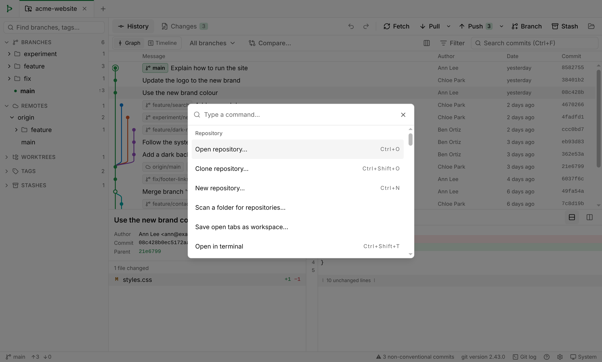
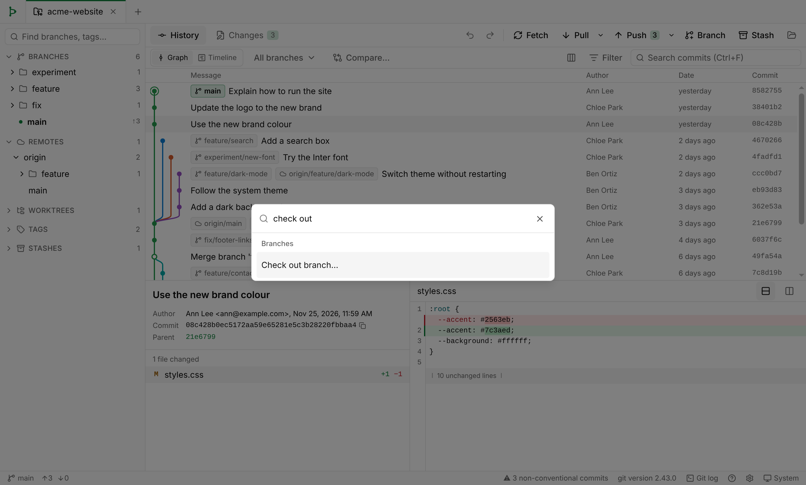
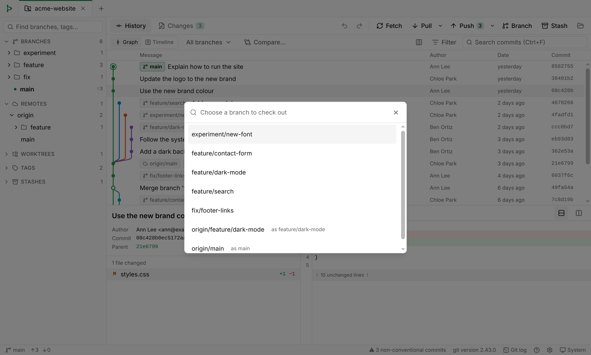

# The command palette

Press **`Ctrl+K`** (**`Cmd+K`** on a Mac; `Ctrl+Shift+P` also works) anywhere in Trellis. A search box opens with every command Trellis has:

Start typing to narrow the list, use the arrow keys to pick, and press **Enter** to run it. **Esc** closes the palette.

## Why use it

- **You don't need to know where things are.** Some actions don't have a button at all, like **Find lost commits**, **Branch stack** or **Git LFS: locked files**. If you can describe it, type it.
- **It's quicker than the mouse.** `Ctrl+K`, type `pull`, Enter.
- **It shows shortcuts.** Commands that have a keyboard shortcut show it on the right, so you learn them as you go.

The list changes with what you're doing: inside a repository you get git commands, during a merge or rebase you get **Continue** and **Abort**, and on the home screen you get the repository commands. Commands added by [plugins](Using-Plugins) appear too, grouped under the plugin's name.

## Commands that ask for more

Some commands need you to choose something, such as which branch. They open a second list in the same box. For example, type `check out`:

Press Enter on **Check out branch…** and the palette lists your branches. Remote branches show the local branch they'll become:

Type to filter the list, then press Enter. To go back to the commands, press **Backspace** in the empty search box.

## Useful commands to try

| Type…            | To…                                                                      |
| ---------------- | ------------------------------------------------------------------------ |
| `switch to`      | Jump to another open repository tab.                                     |
| `check out`      | Switch branch.                                                           |
| `merge`          | Merge a branch into the current one.                                     |
| `compare`        | Compare the current branch with another, or any two branches or commits. |
| `stash`          | Stash your changes, or pop the latest stash.                             |
| `amend`          | Change the last commit.                                                  |
| `lost`           | Find lost commits (the reflog).                                          |
| `clean up`       | Delete branches that are finished.                                       |
| `stack`          | Rebase or push a stack of branches.                                      |
| `workspace`      | Save your open tabs as a workspace, or open one.                         |
| `theme`          | Switch between light, dark and system themes.                            |
| `name and email` | Change the name and email on your commits.                               |
| `reload plugins` | Restart plugins after changing one.                                      |
| `guide`          | Open this user guide, or go straight to one of its pages.                |
| `tips`           | Hide or show the tips on the home screen.                                |
| `report`         | Report a problem or suggest a feature.                                   |

You can change the palette's shortcut, and any other, in **Settings → Keyboard shortcuts**. See [Settings and keyboard shortcuts](Settings-and-Keyboard-Shortcuts).
