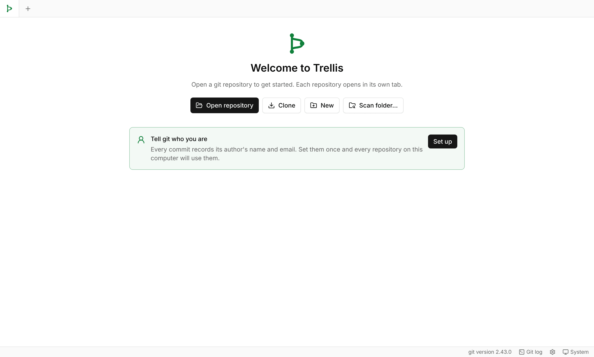
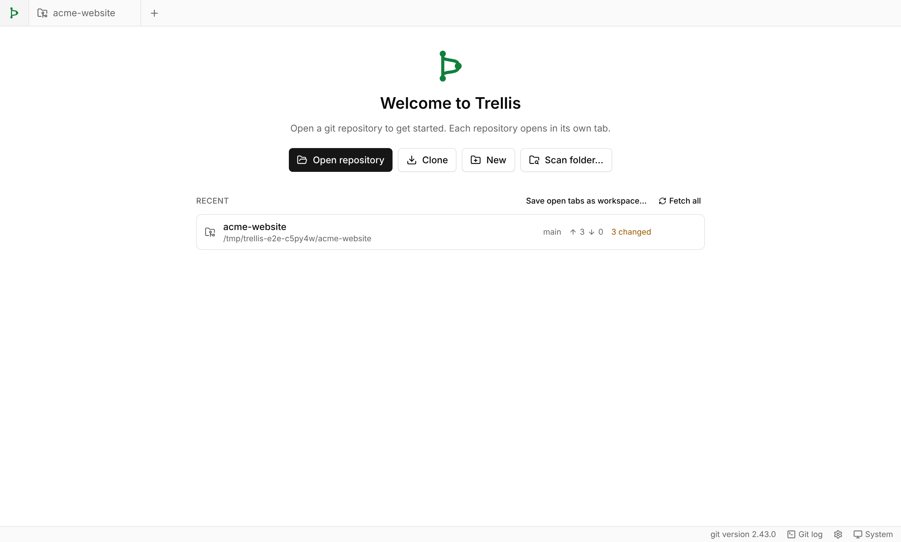

# Getting started

## Install Trellis

Download the installer for your system from the [latest release](https://github.com/ziggfreed/Trellis/releases/latest):

- **Windows**: the `.exe` installer.
- **macOS**: the `.dmg`. Open it and drag Trellis into Applications.
- **Linux**: the `.AppImage` (make it executable and run it) or the `.deb` package.

> **Warnings on first launch.** Until the builds are code-signed, Windows may say "Windows protected your PC" (click **More info → Run anyway**), and macOS may refuse to open the app (open **System Settings → Privacy & Security** and click **Open Anyway**).

Trellis updates itself: when a new version has downloaded, **Restart to update** appears in the status bar.

## Install git

Trellis uses the git already installed on your computer, version **2.34 or newer** (a few features need newer versions; they say so). If git is missing or too old, Trellis tells you and links to the download at [git-scm.com](https://git-scm.com/downloads).

## Tell git who you are

Every commit records the name and email of whoever made it. If git doesn't know yours yet, the home screen shows a card asking for them:

Click **Set up** and enter them. They're saved in git's global settings, so the command line and other git tools use them too. To change them later, open the [command palette](Command-Palette) and run **Set your git name and email…**, or go to **Settings → General**.

## Open a repository

The home screen has four ways in:

| Button              | Shortcut       | What it does                                                                                                           |
| ------------------- | -------------- | ---------------------------------------------------------------------------------------------------------------------- |
| **Open repository** | `Ctrl+O`       | Choose a folder that already contains a git repository.                                                                |
| **Clone**           | `Ctrl+Shift+O` | Copy a repository from a URL (for example from GitHub) into a folder you choose, with progress as it downloads.        |
| **New**             | `Ctrl+N`       | Create a new, empty repository in a folder.                                                                            |
| **Scan folder…**    |                | Find every repository inside a folder (say, your projects folder) and add them all at once, optionally as a workspace. |

Each repository opens in its own **tab**, and your tabs come back next time you start Trellis. Repositories you've opened are listed on the home screen with their current branch, how far ahead or behind they are, and how many files have changed:

Get back to the home screen with the Trellis logo at the top left. The **+** next to the tabs opens, clones or creates another repository without going back.

## What next

- Take the [tour of the repository window](The-Repository-Window).
- Learn the [command palette](Command-Palette): `Ctrl+K`, then type.
- Make your first commit: [Staging and committing](Staging-and-Committing).

> **On a Mac**, use `Cmd` wherever these pages say `Ctrl`, except for shortcuts that explicitly say `Ctrl` (like `Ctrl+Tab`).
