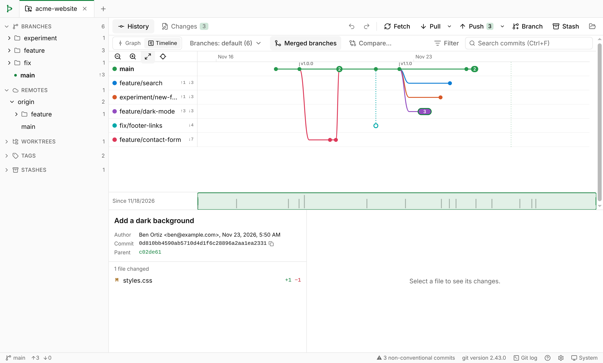
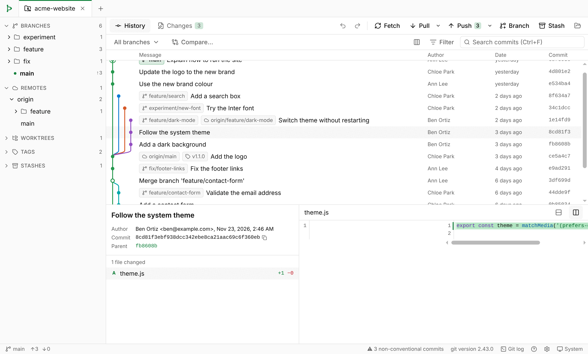
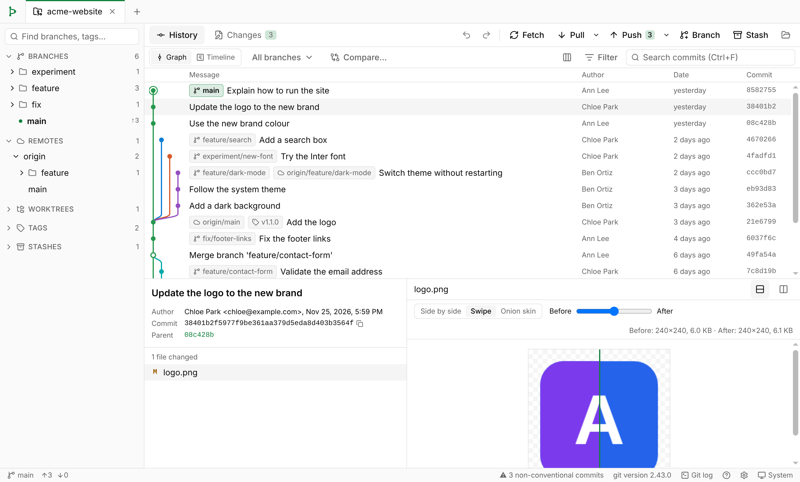
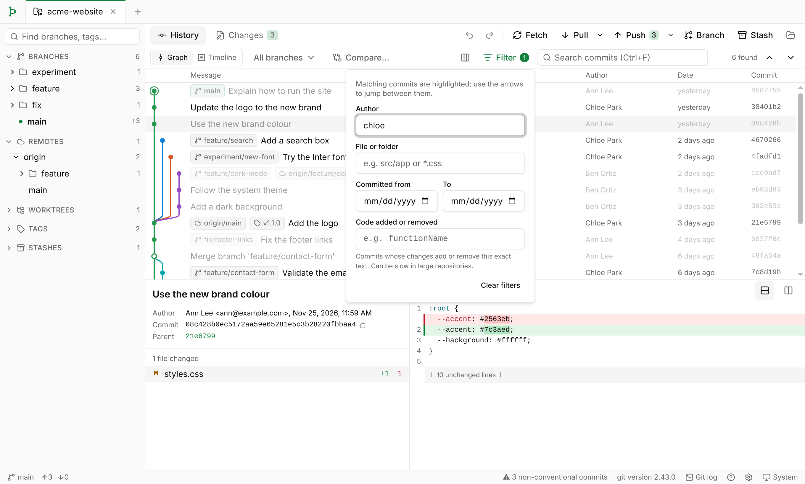

# History and diffs

The **History** view (`Ctrl+Shift+H`) shows every commit as a graph, newest first. Each coloured line is a line of development; where lines join, a branch was merged. Labels show branches (local and remote, with a cloud icon), tags, and the branch you're on (highlighted). The branch you have checked out always stays in the leftmost lane.

The list loads as you scroll and stays smooth even with hundreds of thousands of commits.

## The timeline

Switch between **Graph** and **Timeline** at the top left of the history; Trellis remembers your choice. The timeline turns history on its side: time runs left to right and **each branch gets its own track**, so you can see when a branch started, how long it has been going, where it merged and what was happening at the same time.

- **Moving around**: Ctrl/Cmd+mouse wheel (or the magnifier buttons, or `+`/`-`) zooms; Shift+wheel, a sideways swipe or dragging the background scrolls through time. The other buttons show all loaded history or go back to today. Older history loads as you scroll back.
- **The minimap** under the tracks shows all loaded history, with the visible part in a box. Drag the box, drag its edges to zoom, or click anywhere to jump there.
- **Commits** work as in the graph: click for details, `Ctrl`+click to compare, double-click to check out, right-click for actions. Commits too close together to draw apart become a pill with a count; click it to zoom in. Hover for the message, author and date. With the timeline focused, ←/→ move along a track and ↑/↓ jump to the nearest commit on the track above or below.
- **Which branches**: by default your local branches and remote branches with commits in the last two weeks (the main branch first, then the one you're on). Click **Branches** to tick exactly the ones you want, with a search box: handy when you're chasing a problem across a few branches. **Use default** goes back.
- **Merged branches**: branches that were merged and then deleted have no name in git any more, but their merge commit usually remembers it ("Merge branch 'login'", "Merge pull request #12 from …"). Turn this on to show them, named from those messages.
- **Branch health**: next to each name, ↑ is how many commits the branch has that the main branch doesn't, and ↓ how many the main branch has that it doesn't. Branches with no commits for a month are faded and marked **stale**.

Search and filters work in the timeline too: commits that don't match are faded.

## Looking at a commit

Click a commit to see its details and the files it changed below the graph. Click a file to see its diff. Use the arrow keys to move up and down the list.

- **Unified or side by side**: the two buttons at the top right of the diff. Your choice is remembered (and can be set in Settings).
- **Hover over a branch label** to highlight that branch's line of commits and fade the rest. **Click the label** (or right-click the commit, or the branch in the sidebar, and choose **Highlight**) to keep it highlighted while you scroll; a bar above the list shows which branch it is. Press `Esc` or click **✕** in the bar to stop. The line starts at the branch's commit and follows each commit's first parent back in time, so commits that came in through merges are faded.
- **Click a parent's hash** in the details to jump to it.

### Pictures, Markdown and JSON

Some files get extra views above the diff:

- **Images** are shown as pictures, in three ways: **Side by side**, **Swipe** (drag the slider to wipe between the old and new image) and **Onion skin** (fade the new image over the old, which makes small shifts stand out).

  

- **Markdown** files have **Rendered**: the document as it displays, with added blocks in green and removed ones in red.
- **JSON** files have **Data**: a list of the values that changed, ignoring formatting and key order.

## Which commits are shown

The menu at the top left of the history (**All branches**) switches between:

- **All branches**: everything, including remote branches.
- **Local branches**: hides remote-only branches, which tidies up a busy graph.
- **Current branch**: only the commits on the branch you're on.

**Columns**: the columns button (or right-click a column heading) chooses what's shown next to the message: **Changes** (files and lines changed), **Author**, **Date**, **Committer**, **Commit date** and the **Commit** hash.

## Searching and filtering

**Search** (`Ctrl+F`) finds commits by message, author or hash. Matching commits are highlighted, the count shows how many there are, and the arrows jump between them.

**Filter** narrows it down further:

- **Author**: part of a name or email.
- **File or folder**: commits that changed it, such as `src/app` or `*.css`.
- **Committed from / To**: a date range.
- **Code added or removed**: commits whose changes add or remove this exact text. This is how you find when a function appeared or disappeared. It can be slow in large repositories.

The Filter button shows how many filters are active; **Clear filters** removes them all.

## Comparing

To see everything that's different between two points:

- `Ctrl`+click a second commit to compare it with the selected one.
- Right-click a commit and choose **Compare with current branch**, **Compare with selected commit** or **Compare with…**.
- Right-click a branch in the sidebar and choose **Compare with current branch**.
- Click **Compare…** above the history, or search the palette for `compare`, to pick any two branches, tags or commits.

The Compare view works like a pull request: it lists the commits one side has that the other doesn't, the files changed since the two split, and each file's diff. The swap button flips which side is which.

## Blame and file history

Right-click a file (in the commit details or the Changes view) and choose:

- **Blame**: every line of the file with the commit, author and date that last changed it. Click a commit to see it, or step back to the version before it, to find out who changed a line before that.
- **File history**: every commit that changed the file, following it through renames.

## Finding the commit that broke something (bisect)

If something used to work and now doesn't, bisect finds the commit that broke it by checking out commits halfway between "good" and "bad" until only one is left.

1. Right-click a commit that has the bug (often the newest) and choose **Bisect → Start: this commit has the bug**.
2. Right-click an older commit where it worked and choose **Bisect → Mark good**.
3. Trellis checks out a commit in the middle. Test it, then click **Good**, **Bad** or **Skip** in the banner.
4. Each answer halves the range: about 10 steps for 1,000 commits. When only one is left, the banner names the first bad commit and it's marked in the history.
5. Click **Stop bisecting** to go back to where you were.
