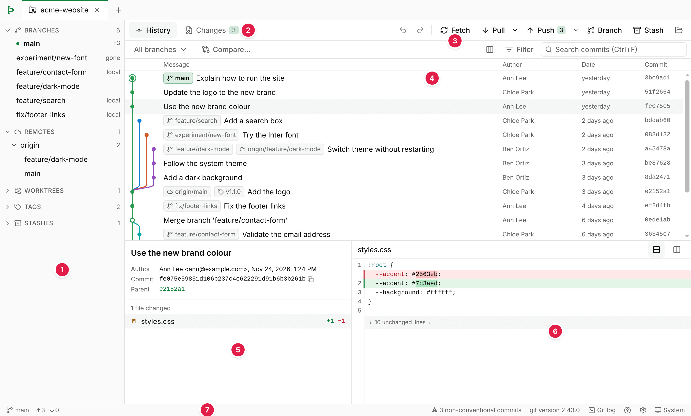

# Trellis

Trellis is a free, open-source desktop app for working with git repositories on Windows, macOS and Linux. It shows your history as a graph, lets you stage, commit, branch, merge and rebase with the mouse or the keyboard, and lets you undo almost anything.

## New to Trellis?

1. [Getting started](Getting-Started): install Trellis, tell git who you are, and open your first repository.
2. [The repository window](The-Repository-Window): a tour of what's on screen.
3. [The command palette](Command-Palette): press **Ctrl+K** (**Cmd+K** on a Mac) and type what you want to do. Every action in Trellis is in there, so this is the one shortcut worth learning first.

## Everyday work

- [History and diffs](History-and-Diffs): the commit graph, searching and filtering, comparing, blame, and image, Markdown and JSON diffs.
- [Staging and committing](Staging-and-Committing): choose exactly what goes in a commit, down to single lines.
- [Branches and remotes](Branches-and-Remotes): create and switch branches, fetch, pull and push, drag and drop branches, and clean up old ones.
- [Merges, rebases and conflicts](Merges-Rebases-and-Conflicts): merging, interactive rebase and the conflict editor.
- [Undo and recovering work](Undo-and-Recovering-Work): Ctrl+Z for git, and finding commits that seem lost.

## More

- [Several repositories](Several-Repositories): tabs, favourites, workspaces and worktrees.
- [Submodules and Git LFS](Submodules-and-Git-LFS)
- [GitHub](GitHub): pull requests and CI results inside Trellis.
- [AI features](AI-Features): optional, with your own API key.
- [Using plugins](Using-Plugins) and [writing plugins](Writing-Plugins).
- [Settings and keyboard shortcuts](Settings-and-Keyboard-Shortcuts)
- [Troubleshooting](Troubleshooting)

## Getting help

Inside Trellis, the **?** button in the status bar opens this guide, and the command palette has **User guide: choose a page…** and **Report a problem or suggest a feature**. If something doesn't work or isn't clear, please [open an issue](https://github.com/ziggfreed/Trellis/issues). These pages live in the [Trellis repository](https://github.com/ziggfreed/Trellis/tree/main/docs/wiki), so you can suggest improvements with a pull request.
