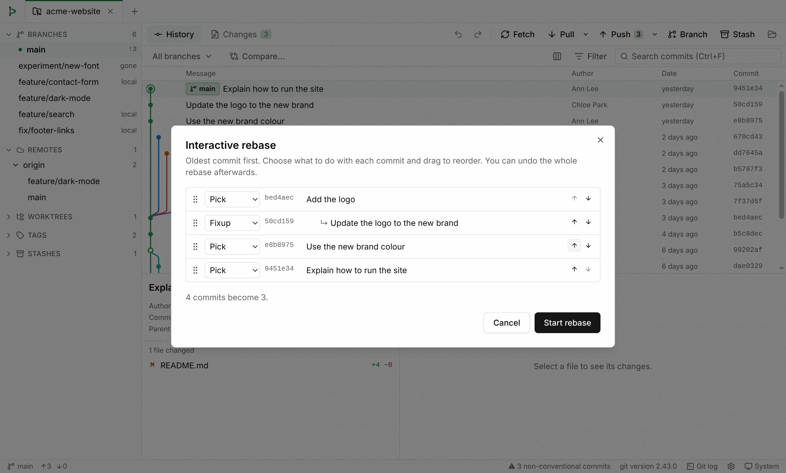
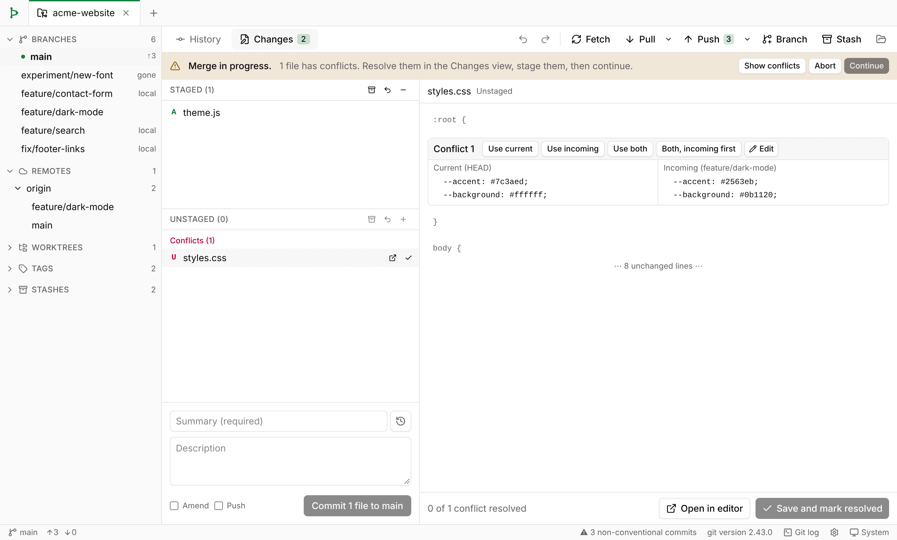

# Merges, rebases and conflicts

## Merge or rebase?

Both bring the work from one branch into another:

- **Merge** joins the two lines of history with a merge commit. Nothing is rewritten, so it's always safe, even on shared branches.
- **Rebase** replays your commits on top of the other branch, as if you'd started from there. History stays in one straight line, but your commits are rewritten (they get new hashes), so avoid rebasing commits other people already have.

If you're unsure, merge.

## Merging and rebasing a branch

Right-click a branch in the sidebar:

- **Merge into current branch…** brings that branch's commits into the one you're on.
- **Rebase current branch onto this…** replays your branch on top of it.

You can also [drag a branch onto another](Branches-and-Remotes#drag-and-drop), or use **Merge branch into current…** in the [command palette](Command-Palette). Either way, [undo](Undo-and-Recovering-Work) (`Ctrl+Z`) puts things back as they were.

## Other ways to move commits around

Right-click a commit in the history:

- **Cherry-pick onto current branch**: copy just this commit onto your branch.
- **Revert…**: make a new commit that undoes this one. Safe for commits you've already pushed.
- **Reset current branch to here**: move your branch back to this commit. **Soft** keeps the changes staged, **Mixed** keeps them unstaged, and **Hard** throws them away (Trellis asks first).

## Interactive rebase: tidying up commits

Before sharing a branch, you might want to reorder commits, merge small fix-ups into the commit they fix, or reword a message. Right-click the oldest commit you want to change and choose **Interactive rebase from here…**:

The commits are listed oldest first. For each one, choose:

| Action     | What happens                                                          |
| ---------- | --------------------------------------------------------------------- |
| **Pick**   | Keep it as it is.                                                     |
| **Reword** | Keep it, with a new message (type it in the box that appears).        |
| **Squash** | Combine it with the commit above, keeping both messages.              |
| **Fixup**  | Combine it with the commit above, keeping only that commit's message. |
| **Edit**   | Stop at this commit so you can change it, then continue.              |
| **Drop**   | Remove it.                                                            |

Drag commits (or use the arrows) to reorder them. The summary underneath tells you what you'll end up with, such as "4 commits become 3". Click **Start rebase**. If it goes wrong, one undo puts the whole rebase back.

## Conflicts

A conflict happens when both sides changed the same lines and git can't tell which to keep. Trellis shows a banner explaining what's going on, with **Continue** and **Abort** (and **Skip commit** during a rebase or cherry-pick, to leave out the commit that conflicts):

1. Click **Show conflicts**. Conflicted files are listed in red under **Conflicts**.
2. Click a file. Each conflict shows the **Current** side (your branch) next to the **Incoming** side (the branch being merged in).
3. For each conflict, choose **Use current**, **Use incoming**, **Use both** (either order), or **Edit** to write the result yourself.
4. When every conflict has a choice, click **Save and mark resolved**. (**Open in editor** lets you resolve it in your own editor instead.)
5. When all files are resolved, click **Continue** in the banner. For a merge, this makes the merge commit.

Changed your mind? **Abort** puts everything back to how it was before the merge or rebase started.

With [AI](AI-Features) turned on, **Ask AI** explains a conflict and suggests a resolution you can review before applying it.
