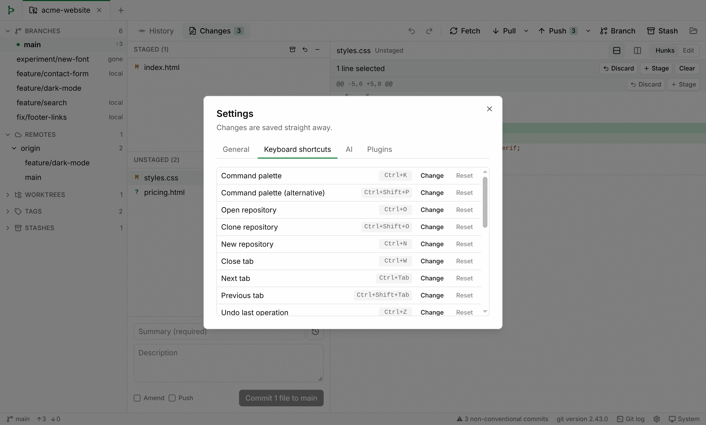

# Settings and keyboard shortcuts

Open Settings with **`Ctrl+,`** (or the gear in the status bar). Changes are saved straight away.

- **General**: theme, diff layout, the editor used by **Open in editor**, how often to fetch in the background, your git name and email, commit signing, whether to show tips on the home screen, and updates.
- **Keyboard shortcuts**: change any shortcut.
- **AI**: see [AI features](AI-Features).
- **Plugins**: see [Using plugins](Using-Plugins).

## Keyboard shortcuts

On a Mac, use `Cmd` instead of `Ctrl`, except for `Ctrl+Tab`, `Ctrl+Shift+Tab` and `` Ctrl+` ``.

| Action                    | Shortcut                             |
| ------------------------- | ------------------------------------ |
| Command palette           | `Ctrl+K` (or `Ctrl+Shift+P`)         |
| Open / clone / new        | `Ctrl+O` / `Ctrl+Shift+O` / `Ctrl+N` |
| Close tab                 | `Ctrl+W`                             |
| Next / previous tab       | `Ctrl+Tab` / `Ctrl+Shift+Tab`        |
| Undo / redo               | `Ctrl+Z` / `Ctrl+Shift+Z`            |
| Search commits            | `Ctrl+F`                             |
| History / Changes         | `Ctrl+Shift+H` / `Ctrl+Shift+G`      |
| Commit                    | `Ctrl+Enter` in the commit box       |
| Save a file being edited  | `Ctrl+S`                             |
| Open in terminal / editor | `Ctrl+Shift+T` / `Ctrl+Shift+E`      |
| Git log                   | `` Ctrl+` ``                         |
| Settings                  | `Ctrl+,`                             |

In the history, the up and down arrow keys move between commits. In the tab bar, the arrow keys move between tabs and `Delete` closes the focused one.

**Fetch**, **Pull**, **Push**, **Stash changes** and **Create branch** have no shortcut by default; give them one if you use them a lot.

### Changing a shortcut

In **Settings → Keyboard shortcuts**, click a shortcut and press the keys you want. Trellis warns if they're already used by another action.

## Commit signing

To sign your commits (so others can check they really came from you), tick **Sign my commits** in **Settings → General** and choose a GPG key or an SSH key. GPG keys need gpg installed. These are git's own settings, so the command line signs too.

The commit details show whether a commit is signed and whether its signature checks out.

## Updates

Trellis checks for new versions in the background and downloads them. When one is ready, click **Restart to update** in the status bar (or it installs the next time you quit). Turn this off, or check now, in **Settings → General → Updates**.

On macOS, builds that aren't signed yet can't install updates themselves; they show a link to download the new version instead.
