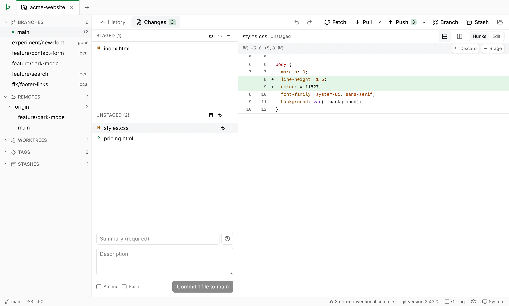
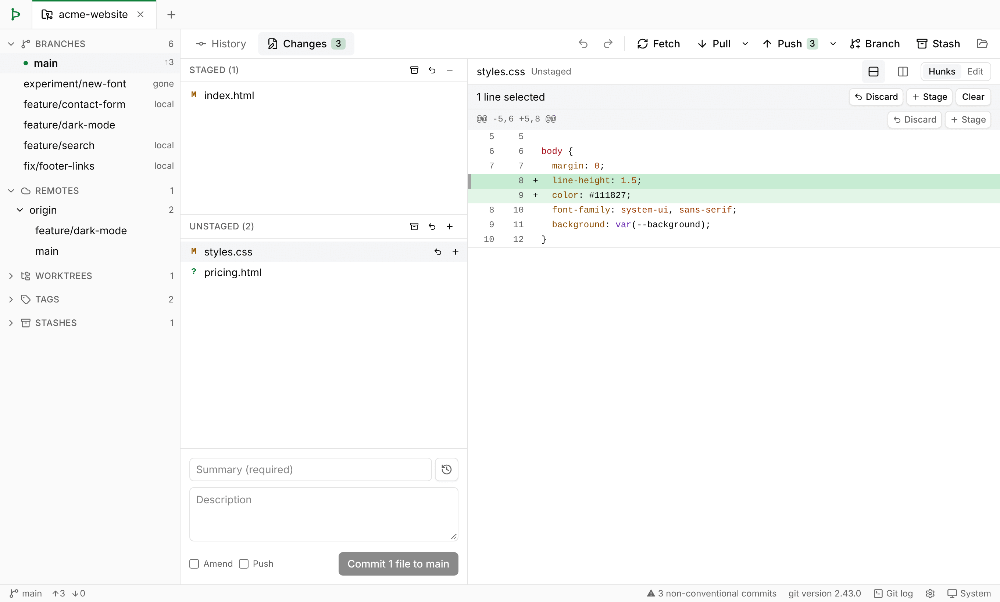

# Staging and committing

A commit is a snapshot of the changes you choose. Git doesn't automatically include everything you've changed: you **stage** what should go in the next commit first. That lets you split your work into tidy commits, even down to single lines.

Open the **Changes** view (`Ctrl+Shift+G`, or **Changes** at the top):

- **Staged** (top): what the next commit will contain.
- **Unstaged** (below): everything else you've changed, including new files (marked `?`).
- The **diff** of the selected file is on the right.
- The **commit box** is at the bottom left.

Drag the divider between the two lists to resize them.

## Staging files

- Click **+** on a file to stage it, or **+** on the Unstaged header to stage everything (**Stage all**).
- **Double-click** a file to move it between the lists.
- **Drag** files from one list to the other.
- **Select several files** with `Ctrl`+click (or `Cmd`+click) and `Shift`+click for a range. The header buttons then say **Stage selected**, **Stash selected** and so on, and act on just those files.

Staged files move back with **−** (or **Unstage all** on the Staged header).

## Staging part of a file

You don't have to commit a whole file. In the diff on the right:

- Each block of changes (a **hunk**) has its own **Stage** and **Discard** buttons.
- **Click a changed line** to select it, and `Shift`+click to select a range. The toolbar then shows how many lines are selected, with buttons that act on just those lines:

The rest stays unstaged, ready for another commit. In the Staged list, the same buttons **Unstage** lines instead. This works in both unified and side-by-side layouts.

## Writing the message

1. **Summary**: one line saying what the commit does, ideally under about 72 characters (the box warns when it's long).
2. **Description** (optional): why, and anything a reviewer should know.
3. Click **Commit** or press `Ctrl+Enter`.

**Reusing a message.** The clock button next to the summary lists your recent commit messages, which is handy when several commits belong to one ticket. Click one to fill in both parts, or use its **Summary** or **Description** button to take just one.

**Options under the message:**

- **Amend** replaces the last commit instead of making a new one, for example to fix a typo in its message or add a forgotten file.
- **Push** pushes straight after committing. It stays ticked until you untick it. After amending a commit you'd already pushed, Trellis offers a safe force push.

With [AI](AI-Features) turned on, **Suggest** writes a message from your staged changes. The built-in [Conventional Commits plugin](Using-Plugins) can help you write messages like `feat(ui): add dark mode`.

## Throwing changes away

- **Discard** on a file, a hunk or selected lines throws away those unstaged changes.
- **Discard all** on the Unstaged header throws away every unstaged change.
- In the Staged list, **Discard staged changes** puts files back to the last commit, losing their staged and unstaged changes (files added since are deleted).

Trellis asks first, and [undo](Undo-and-Recovering-Work) (`Ctrl+Z`) brings discarded changes back.

## Stashing: putting work aside

A **stash** saves changes and removes them from your working files, so you can switch to something else and come back later.

- **Stash** in the toolbar stashes everything (with an optional message, and optionally new files too).
- **Stash selected** (or the stash button on a list header) stashes only some files, so you can commit the rest now.
- Your stashes are in the sidebar under **Stashes**. Click one to see its changes; right-click it to **apply**, **pop** (apply and delete) or **delete** it.

## Editing a file in the diff

Choose **Edit** above a file's diff to change it right there. What git has is shown inline, so you can see your changes as you type. Press `Ctrl+S` (or **Save**) to save it.

## Ignoring files

Right-click a file and choose **Ignore** to add the file, every file with its extension, or its folder to `.gitignore`. If matching files are already committed, Trellis offers to stop tracking them (they stay on your computer).
