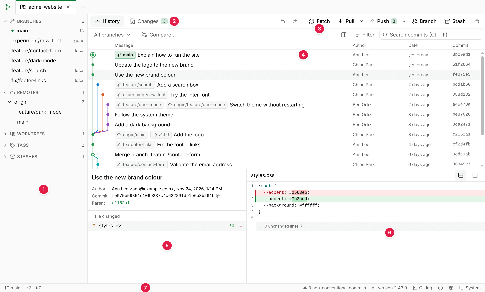
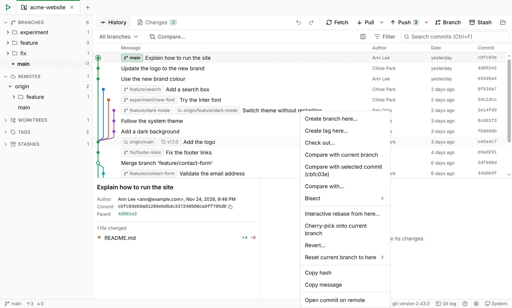
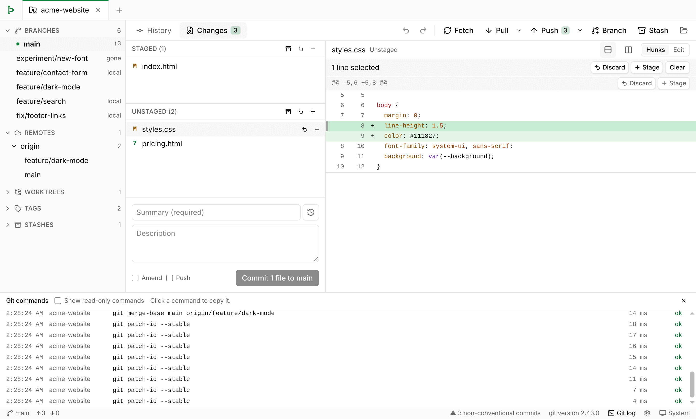

# The repository window

When you open a repository, its tab looks like this:

1. **Sidebar.** Your branches, remotes, worktrees, tags and stashes, plus panels added by plugins (such as GitHub's pull requests). Click an item to show its commit in the history. **Right-click** any item for its actions (check out, merge, rename, delete, push…), and **double-click** a branch to switch to it. Collapse a section by clicking its heading.
2. **History and Changes.** Switch between the commit graph (**History**, `Ctrl+Shift+H`) and your uncommitted work (**Changes**, `Ctrl+Shift+G`). The number on Changes is how many files you've changed.
3. **Toolbar.** Undo and redo, **Fetch**, **Pull** and **Push** (the arrows next to Pull and Push have more options, such as pull with rebase or force push), **Branch** to create one, **Stash** to put your changes aside, and a button to open the folder.
4. **History.** Every commit as a graph, newest first, with branch and tag labels. See [History and diffs](History-and-Diffs).
5. **Commit details.** The selected commit's message, author, date, parents and changed files.
6. **Diff.** What changed in the selected file. Switch between unified and side-by-side with the buttons at the top right.
7. **Status bar.** The current branch and how many commits it's ahead (↑) and behind (↓) its remote branch, any running operation (such as a fetch, with progress), items from plugins, the **Git log**, the **?** button (opens this user guide), Settings, and the theme (System, Light or Dark).

Drag the dividers between panels to resize them; Trellis remembers the sizes.

## Right-click everything

Most actions live on right-click menus, so when you're not sure how to do something with a commit, branch, tag, stash, remote or file, right-click it. For example, a commit's menu:

If you'd rather type, everything in these menus is also in the [command palette](Command-Palette).

## Trellis keeps up with other tools

Trellis watches the repository's files, so changes you make in an editor, a terminal or another git tool appear straight away. It also fetches from your remotes in the background every 10 minutes (change or turn this off in **Settings → General**).

## The git log: see exactly what Trellis runs

Trellis runs ordinary git commands. To see them, click **Git log** in the status bar (or press `` Ctrl+` ``):

Each line shows when a command ran, in which repository, how long it took and whether it worked. Click a command to copy it. Commands that only look at the repository (such as `git status`) are hidden unless you tick **Show read-only commands**. This is handy for learning git, and for working out what happened when something fails.
