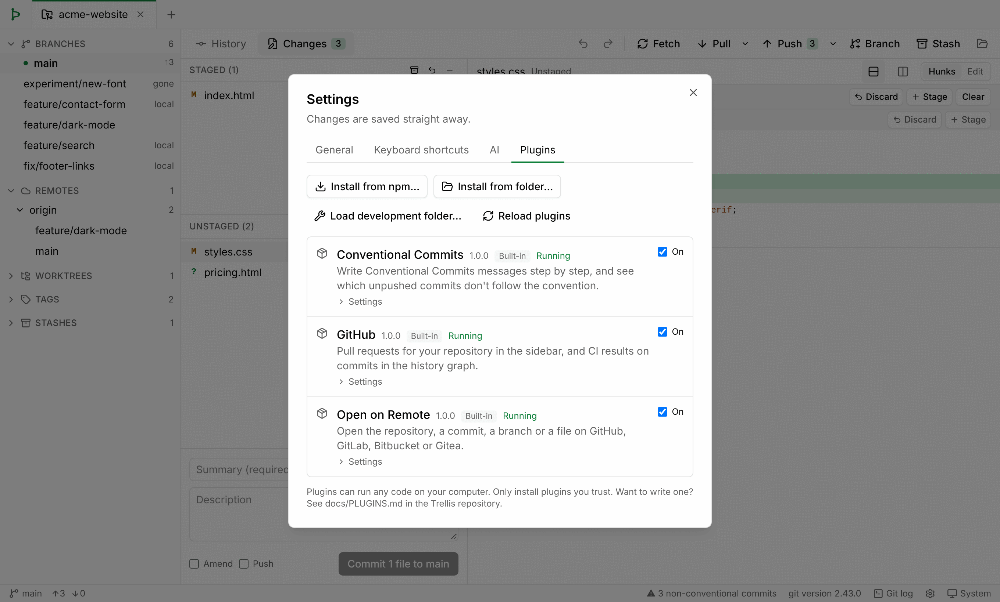

# Using plugins

Plugins add commands, right-click menu items, sidebar panels, status bar items and settings to Trellis. Manage them in **Settings → Plugins** (`Ctrl+,`, then the **Plugins** tab, or **Manage plugins…** in the [command palette](Command-Palette)):

## Built-in plugins

Three plugins come with Trellis. Turn any of them off with its **On** box.

| Plugin                   | What it does                                                                                                                                                                                                             |
| ------------------------ | ------------------------------------------------------------------------------------------------------------------------------------------------------------------------------------------------------------------------ |
| **Conventional Commits** | Helps you write messages like `feat(ui): add dark mode` step by step (run **Write a conventional commit message…** from the palette), and shows in the status bar how many unpushed commits don't follow the convention. |
| **GitHub**               | Pull requests in the sidebar and CI results on commits. See [GitHub](GitHub).                                                                                                                                            |
| **Open on Remote**       | Opens the repository, a commit, a branch or a file on GitHub, GitLab, Bitbucket or Gitea, from right-click menus and the palette.                                                                                        |

Click **Settings** under a plugin to change its options.

## Installing plugins

- **Install from npm…**: type the package name. Trellis picks the newest version that works with your version of Trellis.
- **Install from folder…**: copies a plugin folder into Trellis's plugins folder.
- **Load development folder…**: uses a folder in place, for plugins you're writing. See [Writing plugins](Writing-Plugins).

Remove an installed plugin with its **Uninstall** button (development folders have **Remove**, which leaves the folder alone).

> **Only install plugins you trust.** Plugins run with the same access to your computer as Trellis itself: they can read your files and run commands. Trellis reminds you of this whenever you install one.

## When a plugin misbehaves

- If a plugin fails to start, the error is shown under it in Settings → Plugins.
- Errors from a plugin's commands appear as notifications.
- Turn the plugin off with its **On** box, or click **Reload plugins** to restart them all.

Plugins run in their own process, so a slow or crashing plugin can't freeze Trellis.
